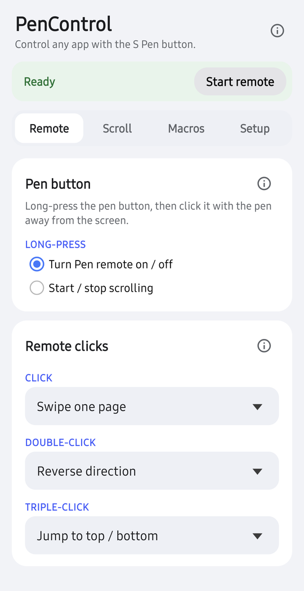
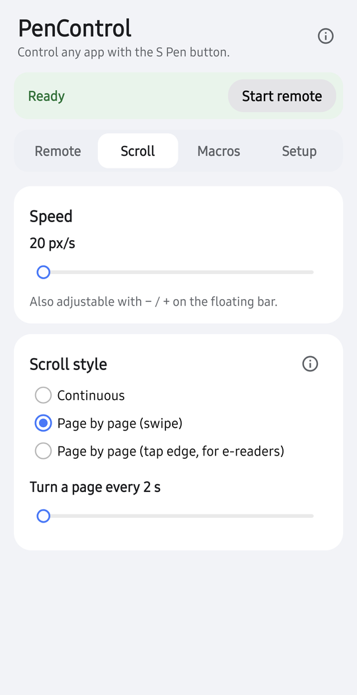
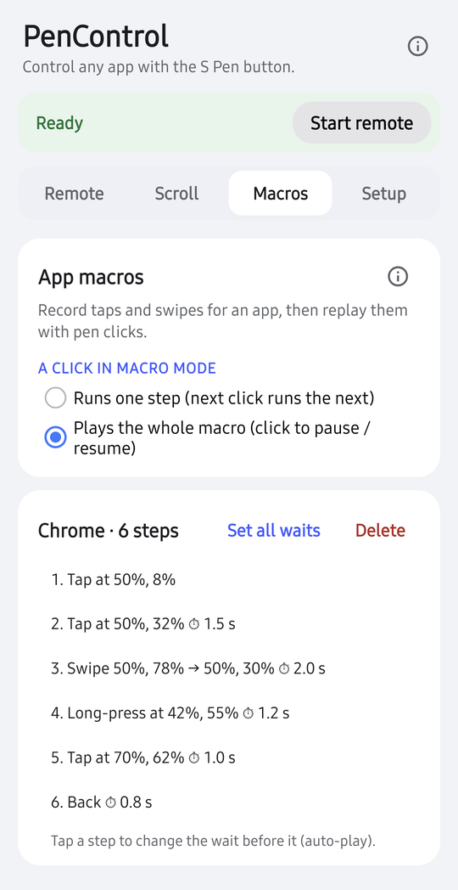
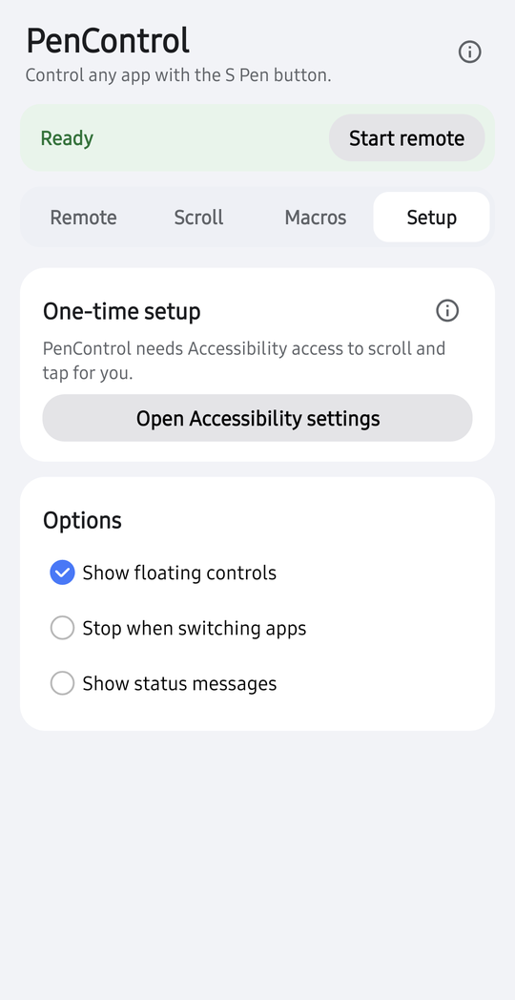
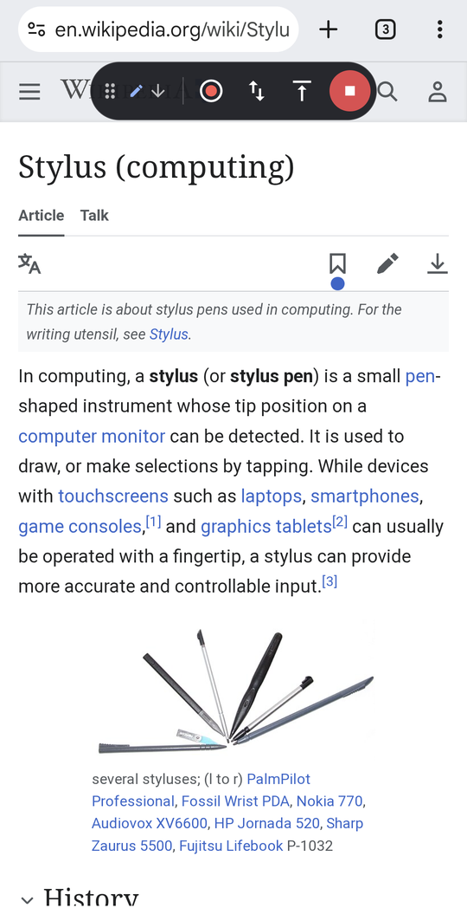
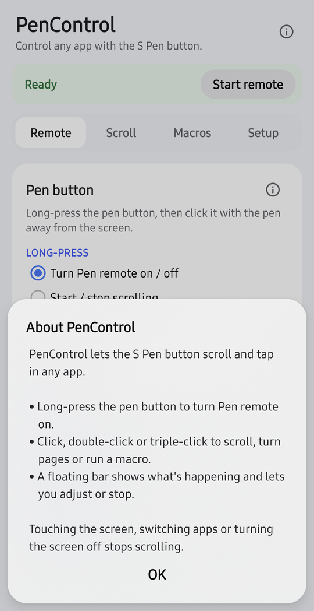

<div align="center">


# PenControl

**Hands-free scrolling and tap macros in any app, controlled by the Galaxy S Pen button.**

[](https://github.com/parthjani7/PenControl/releases/latest)
[](https://github.com/parthjani7/PenControl/releases)
[](LICENSE)


[](https://github.com/parthjani7/PenControl/stargazers)

<a href="https://buymeacoffee.com/parthjani"></a>

[Features](#-features) •
[Screenshots](#-screenshots) •
[Install](#-install) •
[Setup](#-phone-setup) •
[How it works](#-how-it-works) •
[Support](#-support-the-project)

</div>

---

Read long articles, follow sheet music or recipes, or page through an e-book without touching the
screen. Long-press the S Pen button to turn on **Pen remote**. After that, each click of the pen
can scroll, turn a page or run a recorded tap sequence in the app on screen.

## ✨ Features

| | |
|---|---|
| 🖊️ **Pen remote** | Long-press to turn it on, then click with the pen away from the screen. You choose what click, double-click and triple-click do. |
| 📜 **Smooth auto-scroll** | Continuous scrolling at 20–1500 px/s, with no jumps or flings. |
| 📖 **Page turning** | A no-fling swipe or an edge tap every N seconds. The edge tap works in e-readers such as Kindle and Play Books. |
| 🎯 **App macros** | Record taps, long-presses, swipes, Back and Home for one app. Replay them one click per step, or let one click play the whole macro. |
| ⏱️ **Editable timing** | Auto-play waits as long as you did while recording. You can change the wait for any step. |
| 🫧 **Floating bar** | Shows the direction, speed or macro step, with controls for speed, reverse, jump, record and stop. You can drag it anywhere. |
| ⚡ **Quick Settings tile** | Start and stop scrolling from the notification shade. |
| 🛑 **Safe by default** | Scrolling stops when you touch the screen, switch apps or turn the screen off. |
| 🔒 **Private** | No internet permission and no tracking. It never reads what's on screen. |

### Pen actions

| Click | Double-click | Triple-click | Long-press |
|---|---|---|---|
| Start / stop auto-scroll *(default)* | Reverse direction *(default)* | Jump to top / bottom *(default)* | Pen remote on / off |

You can set any click to: start / stop auto-scroll, swipe one page, reverse direction, jump to
top / bottom, faster, slower, or nothing.

## 📸 Screenshots

<div align="center">
<table>
  <tr>
    <td align="center"><br /><sub><b>Pen remote</b></sub></td>
    <td align="center"><br /><sub><b>Speed &amp; style</b></sub></td>
    <td align="center"><br /><sub><b>App macros</b></sub></td>
  </tr>
  <tr>
    <td align="center"><br /><sub><b>Setup</b></sub></td>
    <td align="center"><br /><sub><b>Floating bar</b></sub></td>
    <td align="center"><br /><sub><b>Built-in help</b></sub></td>
  </tr>
</table>
</div>

## 📦 Install

### Download

<a href="https://github.com/parthjani7/PenControl/releases/latest"></a>

Get the latest signed APK from [Releases](https://github.com/parthjani7/PenControl/releases/latest), open it on your phone,
then follow the [phone setup](#-phone-setup).

### Requirements

- A Samsung Galaxy phone with a Bluetooth S Pen that supports **Air actions** (e.g. S23 Ultra).
- Android 11 (API 30) or newer.

### Build from source

You need JDK 17–24 (Gradle 8.14 doesn't run on JDK 25) and the Android SDK with platform 36.

```sh
git clone https://github.com/parthjani7/PenControl.git
cd PenControl
./gradlew assembleDebug
adb install -r app/build/outputs/apk/debug/app-debug.apk
```

> [!TIP]
> On Windows, use `gradlew.bat`. On Samsung phones with Dual Messenger or Secure Folder, add
> `--user 0` to the install command. The copy in the other profile has its own accessibility
> switch, and Air actions may pick it.

## 📲 Phone setup

1. **Turn on Accessibility.** Open PenControl, tap **Open Accessibility settings**, then go to
   Installed apps → PenControl → On.
2. **Turn on Air actions.** Go to Settings → Advanced features → S Pen → **Air actions** → On.
3. **Pick PenControl for long-press.** Set **Hold down Pen button to** to **PenControl**.
4. **Give Air command notification access.** Go to Settings → Notifications → **Notification
   access** and allow **Air command**. Pen remote needs this.
5. **Allow PenControl's notifications** when it asks.

> [!NOTE]
> Android blocks step 1 at first for apps installed outside the Play Store. Go to App info → ⋮ →
> **Allow restricted settings**, then try again.

> [!IMPORTANT]
> Apps with their own Air actions, such as Camera, keep pen clicks for themselves. Turn those off
> in the Air actions screen if you want PenControl to get the clicks in that app.

## 🎬 Recording a macro

1. Open the app and long-press the pen button to turn on Pen remote.
2. Tap ⏺ on the floating bar.
3. Each touch becomes a step: tap, long-press or swipe. The touch also goes through to the app,
   so you can move through its screens while recording. Back and Home are on the toolbar.
4. Tap **Save**.

In that app, long-press now cycles through **off → macro mode → scroll mode → off**. In macro
mode, click runs the next step, double-click goes back one step and triple-click restarts.

## 🔧 How it works

<details>
<summary><b>How PenControl gets pen clicks</b></summary>

<br />

Samsung only lets third-party apps use the pen's long-press, which launches an app. PenControl's
launcher icon opens an invisible activity. If the launch comes from the home screen, the activity
opens settings. From anywhere else, the launch counts as a pen long-press.

Single and double clicks reach PenControl as media buttons:

1. While Pen remote is on, PenControl holds a `MediaSession` in the playing state and posts a media
   notification.
2. Air actions sends remote clicks to the app that owns the active media notification. It sends
   play/pause for a click and "next" for a double-click.
3. PenControl plays half a second of silence so that it becomes the phone's media-button target
   ahead of any music app.
4. There is no native triple-click. A click that comes soon after a double-click counts as one.

While Pen remote is on, your music app doesn't get pen clicks. Play music again to hand them back.

</details>

<details>
<summary><b>Smooth scrolling without flings</b></summary>

<br />

`PenScrollService` injects one long finger drag made of 100 ms `continueStroke` segments, so speed
changes and stops take effect within about 100 ms. When the finger runs out of room, it holds
still before lifting, so the app doesn't fling, then grabs again at the other end.

</details>

<details>
<summary><b>Macros</b></summary>

<br />

Macros are stored per app as JSON. Positions are saved as fractions of the screen size.

- **Recording:** a full-screen overlay captures each touch, then lets it through to the app.
- **Swipes:** a swipe keeps its path and how long the finger rested before and after moving.
  Sliders and drag handles often need that rest.

</details>

## 🔒 Privacy

- No internet permission. Nothing is collected or sent anywhere.
- The accessibility service only listens for window changes, to learn which app is in front. It
  cannot read window content (`canRetrieveWindowContent="false"`).
- Settings and macros stay in the app's private storage. Android's own device backup can include
  them.

## 💛 Support the project

PenControl is free and open source. If it saves you some screen taps, you can support it:

<a href="https://buymeacoffee.com/parthjani"></a>

You can also help for free:

- ⭐ **Star the repo** so more S Pen users can find it.
- 🐛 **Report bugs or suggest features** in [Issues](https://github.com/parthjani7/PenControl/issues).
- 📣 **Share it** on r/GalaxyS23Ultra, r/samsung or XDA.

## ⚠️ Disclaimer

PenControl was built with the help of **Claude Opus 5.5**, Anthropic's AI model. It is a personal
project, provided **as is, with no guarantee or warranty of any kind**. It injects touches into
other apps, so use it at your own risk, especially in apps where an unintended tap matters.
PenControl is not affiliated with or endorsed by Samsung. Galaxy and S Pen are trademarks of
Samsung Electronics.

## 📄 License

Released under the [MIT License](LICENSE).
